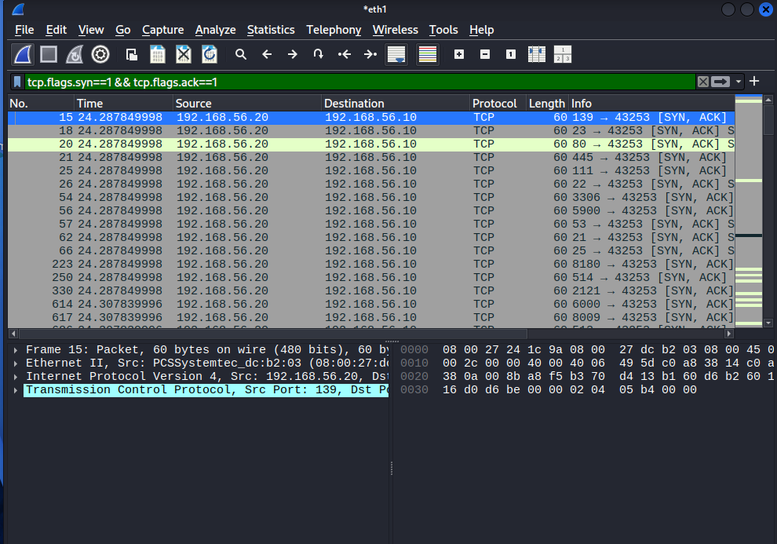

# Security Home Lab

An isolated virtual lab built in VirtualBox to practise safe, legal network scanning and traffic analysis. Built alongside my BSc Cybersecurity studies at Aston University.

## Setup
| Machine | Role | Address |
|---|---|---|
| Kali Linux | Attacker | 192.168.56.10 |
| Metasploitable 2 | Deliberately vulnerable target | 192.168.56.20 |

Both VMs sit on a VirtualBox **internal network**, so the vulnerable target is never exposed to the internet or my home network.

## What I did
1. Built the lab and confirmed the two machines could reach each other with `ping`.
2. Ran `nmap -sV 192.168.56.20` to find open ports and identify service versions.
3. Captured the scan in Wireshark and filtered for the target's replies.
4. Picked out the highest-risk findings and noted how each would be fixed.

Full scan output: [nmap_scan.txt](nmap_scan.txt)

## Results
Nmap found **23 open ports** (977 closed). Most of the target's services are old, outdated versions, which is the main finding.

| Port | Service | Risk | Fix |
|---|---|---|---|
| 1524 | bindshell ("Metasploitable root shell") | Backdoor that hands a root shell to anyone who connects, with no password | Remove the service and block the port with a firewall |
| 21 | vsftpd 2.3.4 | This release is known for a backdoor in its source code (CVE-2011-2523); FTP also sends passwords and files unencrypted | Upgrade to a current release, or use SFTP over SSH |
| 23 | Telnet | Usernames and passwords travel as plain text and can be read by anyone watching the network | Disable Telnet and use SSH |

Other services worth fixing: old MySQL 5.0 and PostgreSQL 8.3 databases exposed on the network, the legacy r-services (512 to 514), and UnrealIRCd on 6667 (some old releases had a backdoor; version not confirmed by Nmap).

## Wireshark observations
Filter used: `tcp.flags.syn==1 && tcp.flags.ack==1`

Open ports answered Nmap's SYN packets with **SYN, ACK**. Closed ports answered with **RST** (filter `tcp.flags.reset==1`). This difference is how a port scan tells open from closed.

## What I learned
- An open port isn't automatically a vulnerability, but every open port is attack surface, so unused services should be turned off.
- Outdated software versions are often the real finding, and each one can be checked against public vulnerability databases such as NVD.
- Isolating a deliberately vulnerable machine on its own network is a basic safety step.

## Safety note
The target is intentionally insecure and only ever ran on an isolated internal network. Only scan systems you own or have explicit permission to test.
